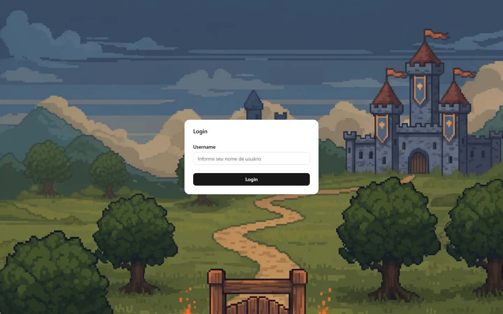
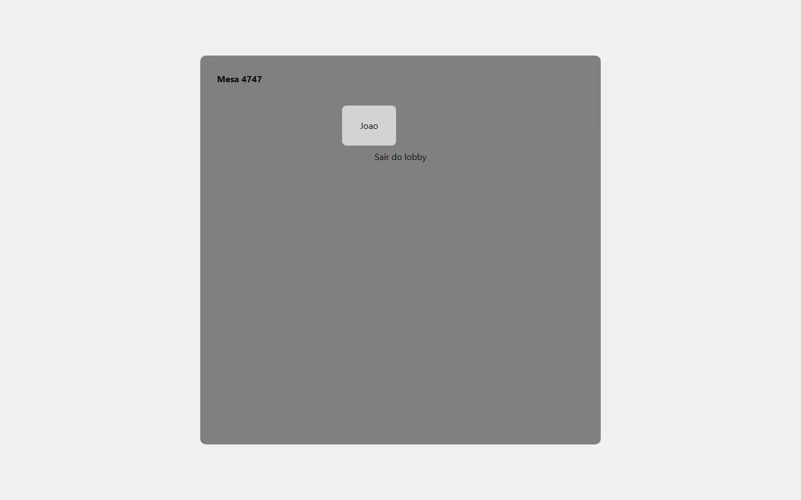
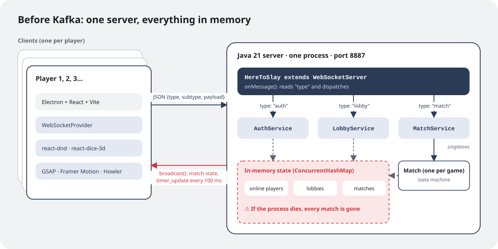
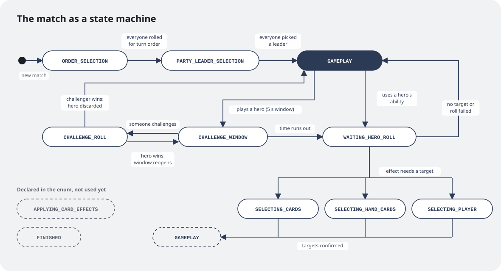
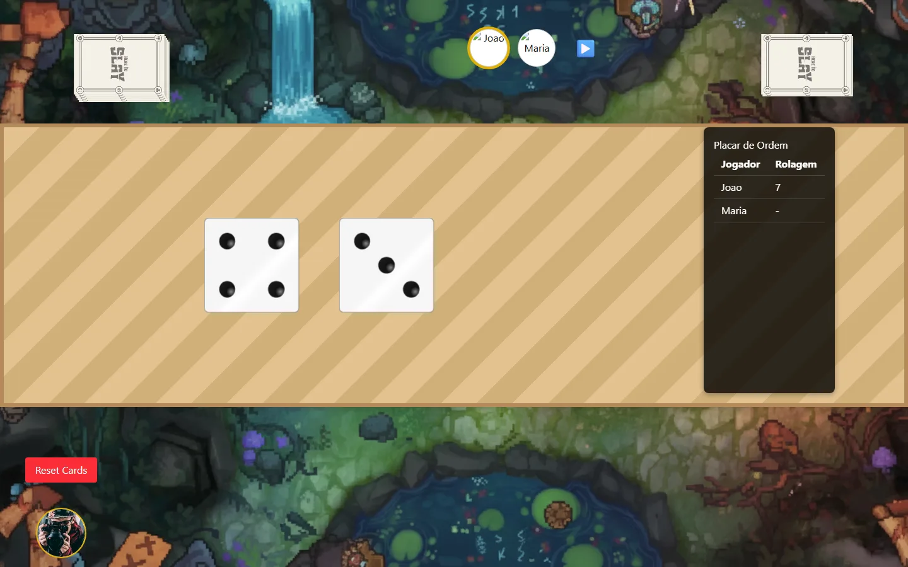
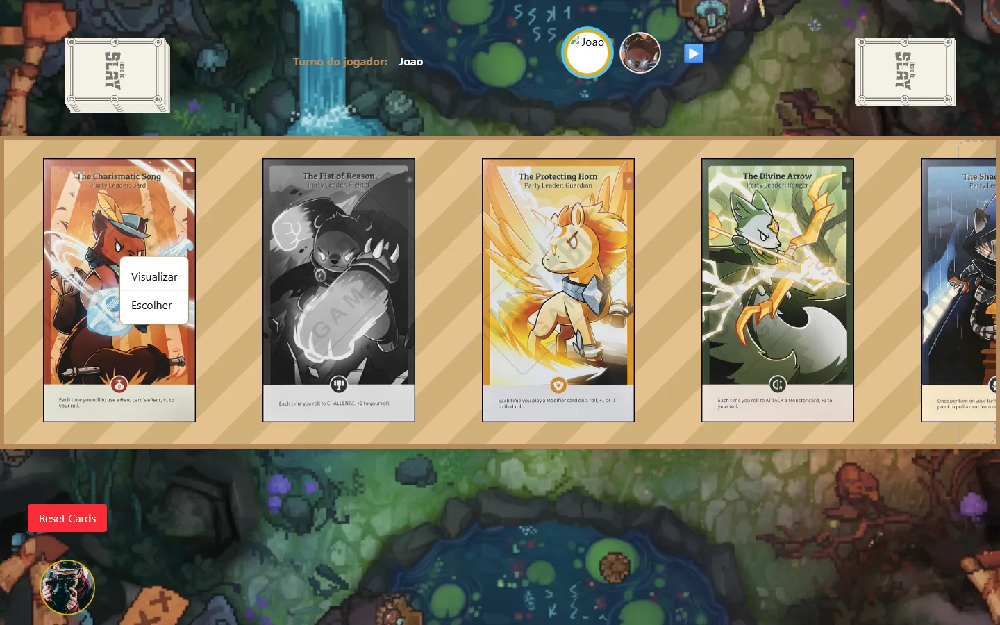
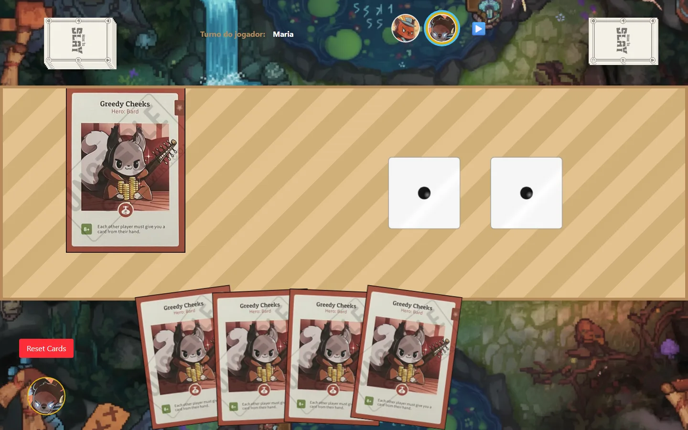
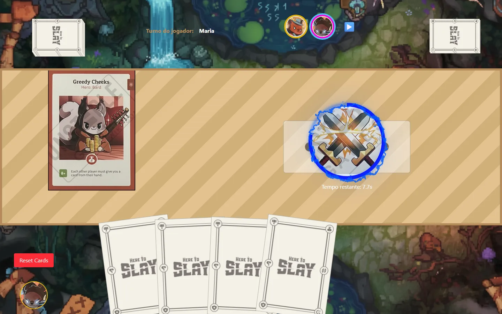
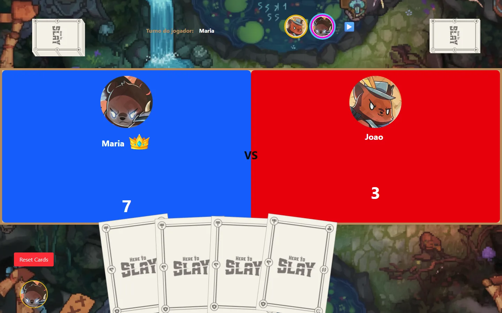
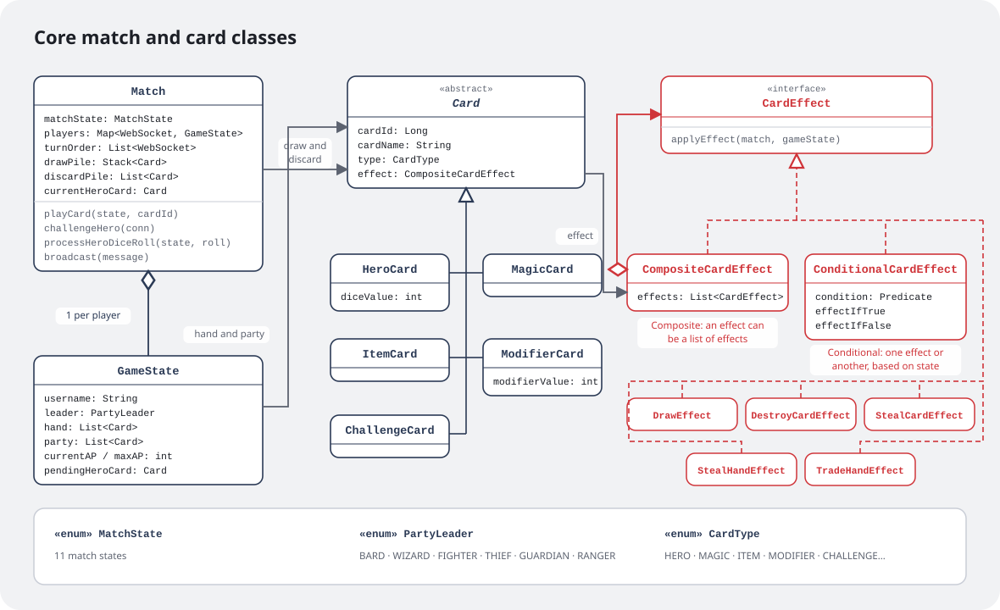

In [part 1](/en/writing/here-to-slay-parte-1/) I told you why I started this project. Now it's time to open up the code. This post covers the first month of development, from September 1 to October 2, 2025: 40 commits that took the game from a login screen to a playable match, with challenges, card effects, animations and sound. It's also the version of the project **before Kafka**, which only arrived months later and deserves a post of its own.

## From zero to a match in a week

The first commit was just an **Electron + React + Vite + TypeScript** app with a login screen. Two days later there was already a server, with login, lobby creation and joining a lobby. On September 8 came match creation and "Gameplay pt.1", and part 2 the next day.

To illustrate this post, I took the code back to the last commit of that month, from October 2, 2025, started the server and opened two windows with two test players, João and Maria. The screens below are from that version, exactly as it was.



Logging in was just a name, no password: the server created the player on the spot and kept it in memory. Next came a list of lobbies, where you could create a room with a minimum and a maximum number of players. Once the minimum was reached, a countdown started, and the match opened on its own when it ended.



From then on the rhythm was: make a mechanic work, stabilize it, make it look good. The challenge window became stable on the 12th, and on the same day came the animations for the party leader, the deck and turn changes, plus the first sound effects. Over the following weeks the card effects arrived one by one: destroy, steal, draw, steal from hand and, last, trading hands with another player.

## One server, one protocol, everything in memory



The architecture was the simplest thing that could work. Each player runs an Electron client, which opens a WebSocket connection to **a single Java 21 server**, written with the Java-WebSocket library. The whole server fits in one class that reads the `type` field of each message and hands it to the right service:

```java
@Override
public void onMessage(WebSocket conn, String message) {
    JSONObject obj = new JSONObject(message);
    switch (obj.getString("type")) {
        case "auth"  -> authService.handleMessage(conn, obj);
        case "lobby" -> lobbyService.handleMessage(conn, obj);
        case "match" -> matchService.handleMessage(conn, obj);
    }
}
```

The protocol followed the same idea: every message is a JSON object with a `type`, a `subtype` and, when needed, a `payload`. To roll the die that sets the turn order, for example, the client sends:

```json
{ "type": "match", "subtype": "order_selection", "id": 1, "payload": { "roll": 9 } }
```

The three services (`AuthService`, `LobbyService` and `MatchService`) were *singletons*, and all state lived in memory, in `ConcurrentHashMap`s: online players, lobbies and matches. There was no database (SQLite made it into the `pom.xml` but was never used), and each player was identified by their WebSocket connection itself.

For a prototype, that was great: zero infrastructure, everything running from a single `main`. The price shows up in the red box of the diagram, and I'll come back to it at the end.

## The match as a state machine

A game of Here To Slay has a lot of phases: rolling for turn order, picking a party leader, playing cards, opening a window for someone to challenge, rolling for a hero, choosing targets for an effect. Handling that with `if`s scattered everywhere would turn into a nightmare, so the `Match` class became an explicit **state machine**:



The state decides what can happen at any moment and also what the client shows. Before any action, the server checks whether it's the sender's turn; if not, it ignores the message. On screen, the challenge button only shows up in `CHALLENGE_WINDOW`, and cards are only selectable in `SELECTING_CARDS` or `SELECTING_HAND_CARDS`.

You can see this on screen. In `ORDER_SELECTION`, the match starts with two 3D dice in the middle of the table. Each player clicks them on their turn, and the scoreboard on the side records the rolls:



In `PARTY_LEADER_SELECTION`, each player picks a party leader, one at a time. Clicking a card opens a small menu to view it larger or choose it, and leaders already taken turn black and white:



And in `GAMEPLAY`, the actual table: the player's party in the middle, the hand at the bottom, the deck and discard pile at the top and the avatars of everyone in the match. A hand full of copies of the same card isn't an accident of the screenshot. At this stage, the deck was built from 120 copies of a single hero, which got whatever effect I was testing that day. In the last commit of the month, it was trading hands.



Two states in the enum, `APPLYING_CARD_EFFECTS` and `FINISHED`, were declared with the future in mind and weren't used yet. That's the kind of thing I leave on purpose as a reminder of what's missing.

## The challenge window

The most interesting mechanic to build was the challenge. When someone plays a hero, every other player has a few seconds to challenge it. The server opens the window, tells everyone and schedules two timers: one that closes the window when time runs out, and another that sends the countdown every 100 ms:

```java
challengeTimer = new Timer();
challengeTimer.schedule(new TimerTask() {
    public void run() { closeChallengeWindow(); }
}, challengeWindowRemainingTime);

challengeTimer.scheduleAtFixedRate(new TimerTask() {
    public void run() { broadcast(timerUpdate(getRemainingTime())); }
}, 0, 100);
```

Since two players can hit "challenge" at almost the same time, the methods that touch this state (`challengeHero`, `processDuelRoll`, `processOrderSelectionRoll`) are `synchronized`: only one gets in at a time. The first challenge pauses the clock, saving the remaining time, and takes both players into a dice duel. Whoever already challenged that hero can't challenge it again. If the hero wins the duel, the window reopens with the time that was left, and another player can still try. If the challenger wins, the hero goes to the discard pile.

For the players who aren't acting, the window shows up as a button in the middle of the table, with the time left right below it. Here Maria has just played a hero, and João has a few seconds to decide:



Clicking it takes both players to the duel screen, blue against red, and each one rolls their own dice. The crown marks the winner. In this case, Maria rolled 7 against João's 3, and her hero stayed in the party:



## Cards as Lego pieces

Here To Slay has dozens of cards, and many effects are combinations of others: "draw a card and destroy a hero", "if you have this hero, steal a card; otherwise, draw two". Writing one class per card wasn't going to scale.



The fix was to separate **what a card is** from **what it does**. Every card (hero, magic, item, modifier or challenge) has an effect, and every effect implements a one-method interface:

```java
public interface CardEffect {
    void applyEffect(Match match, GameState gameState);
}
```

The simple effects (`DrawEffect`, `DestroyCardEffect`, `StealCardEffect`, `StealHandEffect`, `TradeHandEffect`) each do one thing. Two special effects exist to combine the others:

- **`CompositeCardEffect`** (the Composite pattern) holds a list of effects and applies them all in sequence. "Draw and destroy" becomes a composite with two effects.
- **`ConditionalCardEffect`** takes a condition (`Predicate<GameState>`) and applies one effect if it's true and another if it's false.

Since both are also `CardEffect`s, they nest freely: a composite with a conditional inside, which in turn holds another composite. A new card becomes a matter of assembling pieces that already exist, not writing new code.

## The client side

In a card game, half the fun is *feeling* the match. That's why a good chunk of this month's commits went into the client:

- **react-dnd** to drag cards from your hand onto the table and into the challenge arena;
- **react-dice-3d** for the 3D dice;
- **GSAP** and **Framer Motion** for the leader entrance, turn change and deck animations;
- **Howler** for sound effects, like drawing a card or opening a challenge;
- **HeroUI** and **Tailwind** for the interface.

All of it talking to the server through a React `WebSocketProvider`, which spreads incoming messages to the components on screen.

## The limits of this architecture

By early October the game worked, and that's when the problems became clear:

- **Everything in memory, in a single process.** If the server crashed, or if I had to restart it to ship a fix, every match in progress was gone.
- **The player was the connection.** A two-second internet drop meant a new connection and, as far as the server knew, a new player, outside the match.
- **One class doing everything.** `Match` went past 650 lines and mixed game rules, timers and message sending.
- **No way to scale.** Lobbies and matches shared the same process, so neither could be split out or replicated.

After that month the project sat on the shelf for a while. When I came back, in May 2026, it was to tackle exactly these points, and the answer meant breaking the server into services that only talk through events. But that's for part 3: Kafka.
