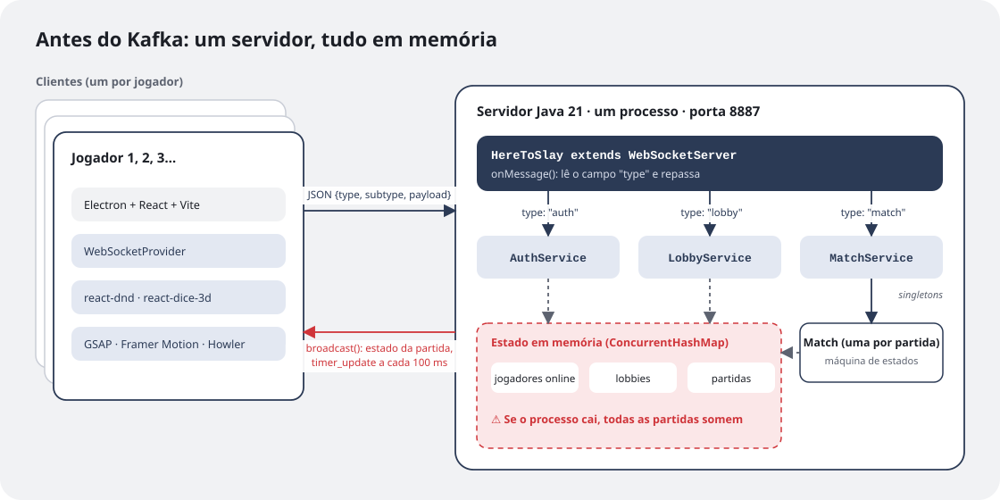
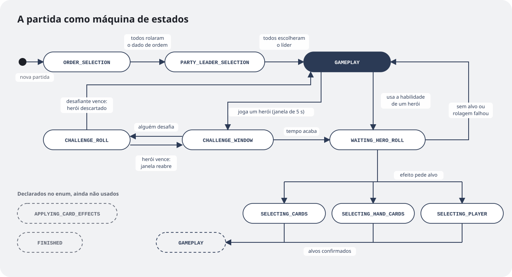
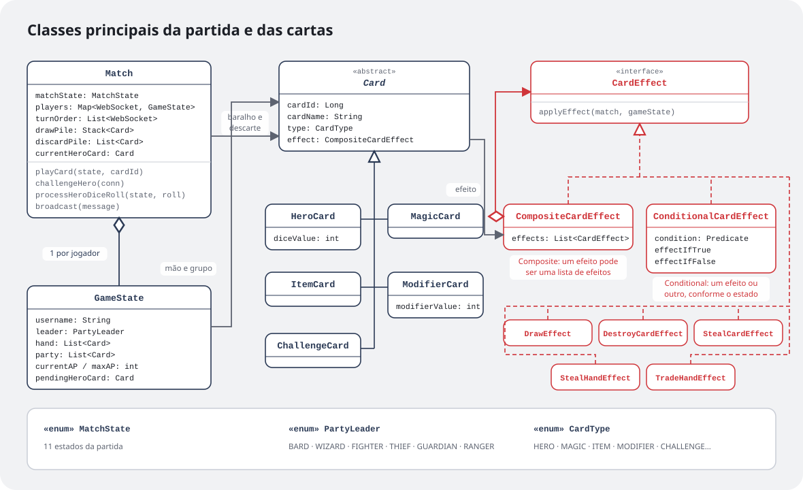

Na [parte 1](/pt/textos/here-to-slay-parte-1/) eu contei por que comecei este projeto. Agora é hora de abrir o código. Este texto cobre o primeiro mês de desenvolvimento, de 1º de setembro a 2 de outubro de 2025: 40 commits que levaram o jogo de uma tela de login a uma partida jogável, com desafios, efeitos de cartas, animações e som. É também a versão do projeto **antes do Kafka**, que só chegou meses depois e merece um texto só para ele.

## Do zero a uma partida em uma semana

O primeiro commit era só um app **Electron + React + Vite + TypeScript** com uma tela de login. Dois dias depois já existia o servidor, com login, criação de lobby e entrada no lobby. No dia 8 de setembro veio a criação da partida e o "Gameplay pt.1", e no dia seguinte a parte 2.

A partir daí o ritmo foi este: fazer uma mecânica funcionar, estabilizar, deixar bonita. A janela de desafio ficou estável no dia 12, e no mesmo dia chegaram as animações do party leader, do baralho e da troca de turno, além dos primeiros efeitos sonoros. Nas semanas seguintes os efeitos das cartas foram entrando um por um: destruir, roubar, comprar, roubar da mão e, por último, trocar de mão com outro jogador.

## Um servidor, um protocolo, tudo em memória



A arquitetura era a mais simples que funcionasse. Cada jogador roda um cliente Electron, que abre uma conexão WebSocket com **um único servidor Java 21**, escrito com a biblioteca Java-WebSocket. O servidor inteiro cabe numa classe que lê o campo `type` de cada mensagem e repassa para o serviço certo:

```java
@Override
public void onMessage(WebSocket conn, String message) {
    JSONObject obj = new JSONObject(message);
    switch (obj.getString("type")) {
        case "auth"  -> authService.handleMessage(conn, obj);
        case "lobby" -> lobbyService.handleMessage(conn, obj);
        case "match" -> matchService.handleMessage(conn, obj);
    }
}
```

O protocolo seguia a mesma ideia: toda mensagem é um JSON com `type`, `subtype` e, quando precisa, um `payload`. Para rolar o dado que define a ordem dos turnos, por exemplo, o cliente manda:

```json
{ "type": "match", "subtype": "order_selection", "id": 1, "payload": { "roll": 9 } }
```

Os três serviços (`AuthService`, `LobbyService` e `MatchService`) eram *singletons*, e todo o estado vivia em memória, em `ConcurrentHashMap`: jogadores online, lobbies e partidas. Não havia banco de dados (o SQLite chegou a entrar no `pom.xml`, mas nunca foi usado), e cada jogador era identificado pela própria conexão WebSocket.

Para um protótipo, isso foi ótimo: zero infraestrutura, tudo rodando com um `main`. O preço aparece na caixa vermelha do diagrama, e eu volto a ele no fim do texto.

## A partida como máquina de estados

Uma partida de Here To Slay tem muitas fases: rolar dados para a ordem, escolher o líder do grupo, jogar cartas, abrir uma janela para alguém desafiar, rolar o dado do herói, escolher alvos para um efeito. Tentar controlar isso com um monte de `if` espalhados viraria um pesadelo, então a classe `Match` virou uma **máquina de estados** explícita:



O estado decide o que pode acontecer em cada momento e também o que o cliente mostra. Antes de qualquer ação, o servidor confere se é a vez de quem mandou; se não for, ignora a mensagem. Do lado da tela, o botão de desafio só aparece em `CHALLENGE_WINDOW`, e as cartas só ficam selecionáveis em `SELECTING_CARDS` ou `SELECTING_HAND_CARDS`.

Dois estados do enum, `APPLYING_CARD_EFFECTS` e `FINISHED`, foram declarados pensando no futuro e ainda não eram usados. É o tipo de coisa que eu deixo de propósito como lembrete do que falta.

## A janela de desafio

A mecânica mais interessante de implementar foi o desafio. Quando alguém joga um herói, todos os outros jogadores têm alguns segundos para desafiar. O servidor abre a janela, avisa todo mundo e agenda dois timers: um que fecha a janela quando o tempo acaba e outro que manda a contagem regressiva a cada 100 ms:

```java
challengeTimer = new Timer();
challengeTimer.schedule(new TimerTask() {
    public void run() { closeChallengeWindow(); }
}, challengeWindowRemainingTime);

challengeTimer.scheduleAtFixedRate(new TimerTask() {
    public void run() { broadcast(timerUpdate(getRemainingTime())); }
}, 0, 100);
```

Como dois jogadores podem clicar em "desafiar" quase ao mesmo tempo, os métodos que mexem nesse estado (`challengeHero`, `processDuelRoll`, `processOrderSelectionRoll`) são `synchronized`: só um entra por vez. O primeiro desafio pausa o relógio, guardando o tempo que faltava, e leva os dois jogadores para um duelo de dados. Quem já desafiou aquele herói não pode desafiar de novo. Se o herói vence o duelo, a janela reabre com o tempo restante, e outro jogador ainda pode tentar. Se o desafiante vence, o herói vai para o descarte.

## Cartas como peças de Lego

Here To Slay tem dezenas de cartas, e muitos efeitos são combinações de outros: "compre uma carta e destrua um herói", "se você tiver tal herói, roube uma carta; senão, compre duas". Escrever uma classe para cada carta não ia escalar.



A solução foi separar **o que a carta é** do **que ela faz**. Toda carta (herói, mágica, item, modificador ou desafio) tem um efeito, e todo efeito implementa uma interface de um método só:

```java
public interface CardEffect {
    void applyEffect(Match match, GameState gameState);
}
```

Os efeitos simples (`DrawEffect`, `DestroyCardEffect`, `StealCardEffect`, `StealHandEffect`, `TradeHandEffect`) fazem uma coisa cada. Dois efeitos especiais servem para combinar os outros:

- **`CompositeCardEffect`** (padrão Composite) guarda uma lista de efeitos e aplica todos em sequência. "Compre e destrua" vira um composite com dois efeitos.
- **`ConditionalCardEffect`** recebe uma condição (`Predicate<GameState>`) e aplica um efeito se ela for verdadeira e outro se for falsa.

Como os dois também são `CardEffect`, dá para aninhar à vontade: um composite com um condicional dentro, que por sua vez tem outro composite. Uma carta nova passa a ser uma questão de montar peças que já existem, não de escrever código novo.

## O lado do cliente

Num jogo de cartas, metade da graça está em *sentir* a partida. Por isso boa parte dos commits desse mês foi no cliente:

- **react-dnd** para arrastar cartas da mão para a mesa e para a arena do desafio;
- **react-dice-3d** para os dados em 3D;
- **GSAP** e **Framer Motion** para as animações de entrada do líder, troca de turno e baralho;
- **Howler** para os efeitos sonoros, como comprar uma carta ou abrir um desafio;
- **HeroUI** e **Tailwind** para a interface.

Tudo isso conversando com o servidor por um `WebSocketProvider` em React, que espalha as mensagens recebidas para os componentes da tela.

## Os limites dessa arquitetura

No começo de outubro o jogo funcionava, e foi aí que os problemas ficaram claros:

- **Tudo em memória, num processo só.** Se o servidor caísse, ou se eu precisasse reiniciar para publicar uma correção, todas as partidas em andamento sumiam.
- **O jogador era a conexão.** Uma queda de internet de dois segundos significava uma nova conexão e, para o servidor, um jogador novo, fora da partida.
- **Uma classe fazendo tudo.** A `Match` passou de 650 linhas e misturava regras do jogo, timers e envio de mensagens.
- **Sem como escalar.** Lobby e partidas dividiam o mesmo processo, então não dava para separar ou replicar nenhuma das partes.

Depois desse mês o projeto ficou parado por um tempo. Quando voltei, em maio de 2026, foi para atacar exatamente esses pontos, e a resposta passou por quebrar o servidor em serviços que só conversam por eventos. Mas isso fica para a parte 3: o Kafka.
