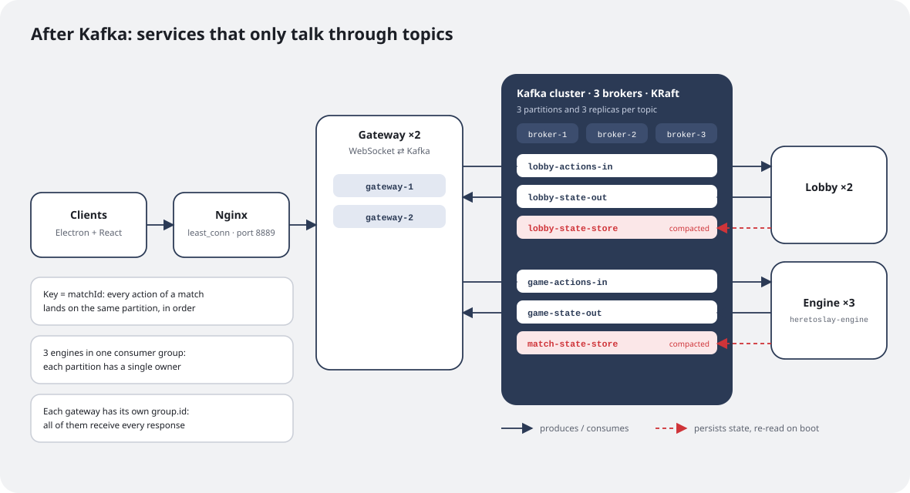
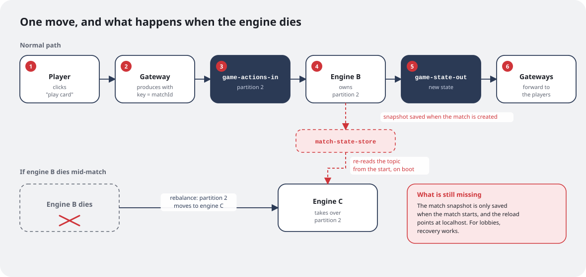

[Part 2](/en/writing/here-to-slay-parte-2/) ended with a list of problems: everything in memory and in a single process, the player identified by the connection, one class doing everything and no way to scale. The project sat for a few months with that list in a drawer, until, in the first half of 2026, I took the **Event-Driven Systems** course at UFES.

That's where I really learned Kafka. And the course project asked for exactly a system built on top of it. I had a multiplayer game with a monolithic server begging to be taken apart, so I put the two together: Here To Slay became the course project, built together with my classmate Gianluca Mantovaneli.

The project had two stages. The first, which is what this post is about, was using "plain" Kafka, with just producers and consumers, to break the server into services. The second was a monitoring service with Kafka Streams, which is coming in part 4.

## The new architecture

One simple rule drove everything: **no service calls another one directly**. All communication goes through Kafka topics, including state persistence.



The single server became three services:

- **Gateway** (2 replicas): the only point of contact with clients. It holds the WebSocket connections but has no game rules at all. Every client message becomes a Kafka message, and every response coming back from Kafka goes to the right player.
- **Lobby** (2 replicas): handles rooms before a match starts.
- **Engine** (3 replicas): owns the game rules, meaning the `Match` and the state machine from part 2, once the match starts.

In front of the gateways sits **Nginx**, load-balancing the WebSockets with `least_conn`: each new connection goes to the gateway with the fewest open connections. Everything starts with a single `docker compose up`, along with a Kafka UI to watch messages flow in real time.

## The topics

There are six topics, organized as input and output pairs for each domain, plus a state topic:

| Topic | Produced by | Consumed by |
|---|---|---|
| `lobby-actions-in` | Gateway | Lobby |
| `lobby-state-out` | Lobby | Gateway |
| `lobby-state-store` (compacted) | Lobby | Lobby, on startup |
| `game-actions-in` | Gateway | Engine |
| `game-state-out` | Engine | Gateway |
| `match-state-store` (compacted) | Engine | Engine, on startup |

The gateway became almost trivial. Instead of calling a service, it just decides which topic the message goes to and with which key:

```java
case "lobby" -> producer.send(new ProducerRecord<>("lobby-actions-in", routingKey, obj.toString()));
case "match" -> producer.send(new ProducerRecord<>("game-actions-in", obj.get("id").toString(), obj.toString()));
```

## The key is what guarantees order

In a turn-based game, the order of actions matters: if I play a card and then attack a monster, the engine has to process them in that order. Kafka only guarantees order **within a partition**, so the key of every message is the `matchId`. Every action of the same match lands on the same partition and arrives in order.

That also solves scaling. The three engines join the **same consumer group** (`heretoslay-engine`), and Kafka splits the three partitions of `game-actions-in` among them. Each partition has a single owner at a time, so each match is processed by exactly one engine, with no two instances fighting over the same state. If an engine dies, Kafka *rebalances* and hands its partitions to the others.



## The gateway trick: a group for each one

Responses travel the opposite way, and that's where an interesting problem showed up. With two gateways, a player's WebSocket connection can be on either one. If the gateways split the `game-state-out` messages the way the engines split the actions, half the responses would end up at the wrong gateway.

The fix was giving each gateway a consumer group of its own:

```java
consumerProps.put("group.id", "heretoslay-gateway-" + UUID.randomUUID());
```

Since each instance is the only member of its own group, **all of them receive every message**. Each gateway looks at the list of players in the message and forwards it only to the ones connected to it. It's the same Kafka doing two opposite things: splitting work among the engines and *broadcasting* among the gateways, just by changing the `group.id`.

Another change came along with it: the player stopped being the connection. Each player now has a `playerId`, and that ID is what the engine uses to tell players apart. The connection became a gateway detail.

## Durability: 3 brokers and `acks=all`

To avoid depending on a single machine, the cluster has **3 brokers** running in **KRaft** mode, the Kafka mode that does away with ZooKeeper. Each topic has 3 partitions and a replication factor of 3, meaning every message lives on three brokers. On the producer side, Gianluca set `acks=all`: a message only counts as sent once every in-sync replica confirms it.

## Compacted topics as a database

This was the part I most wanted to build and the one that taught me the most.

A **compacted** topic (`cleanup.policy=compact`) keeps only the latest message for each key. If every lobby publishes its own state with the `lobbyId` as the key, the topic effectively becomes a table with the current state of every lobby. On startup, the service reads the topic from the beginning (`auto.offset.reset=earliest`) and rebuilds everything in memory, with no database needed.

In the **lobby**, this worked as planned: state is saved on every change, and a restarted lobby comes back exactly as it was.

In the **engine**, while going back through the code to write this post, I found two gaps:

- the match snapshot is only published when the match **starts**, not after each move;
- the reload on startup points to `localhost:9092`, while everything else uses the broker address from the environment, so inside Docker it can't find the cluster.

In practice, if an engine dies, its partition moves to another engine, but the match doesn't come back where it was. The whole structure is there: the compacted topic, the per-match key, the reload on startup. What's missing is saving after every action and fixing the address. It's the first item on my list for the next version, and I'd rather tell you here than pretend it's solved.

## What really changed

Compared to part 2:

- **Scale:** I can run more engines and more gateways without changing a line of code. Kafka redistributes the partitions.
- **Order:** guaranteed per match, by the key.
- **Decoupling:** the gateway doesn't know the engine exists, and vice versa. Both only know topics.
- **Observability:** with the Kafka UI, I can watch every action of every player flow through the topics. That helped a lot with debugging.

The cost is real too: many more pieces to start, more things that can go wrong and new bugs that didn't exist before, like the synchronization errors between lobbies I had to fix in May. For a card game among friends, it's clearly more architecture than needed. But the goal was to learn, and for that it was perfect.

In part 4, I'll talk about the second stage of the project: a monitoring service with Kafka Streams that watches matches and raises alerts like "First Blood" and "Combo" without touching the main game flow.
