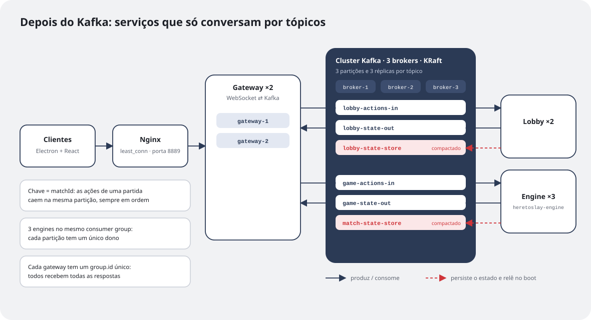
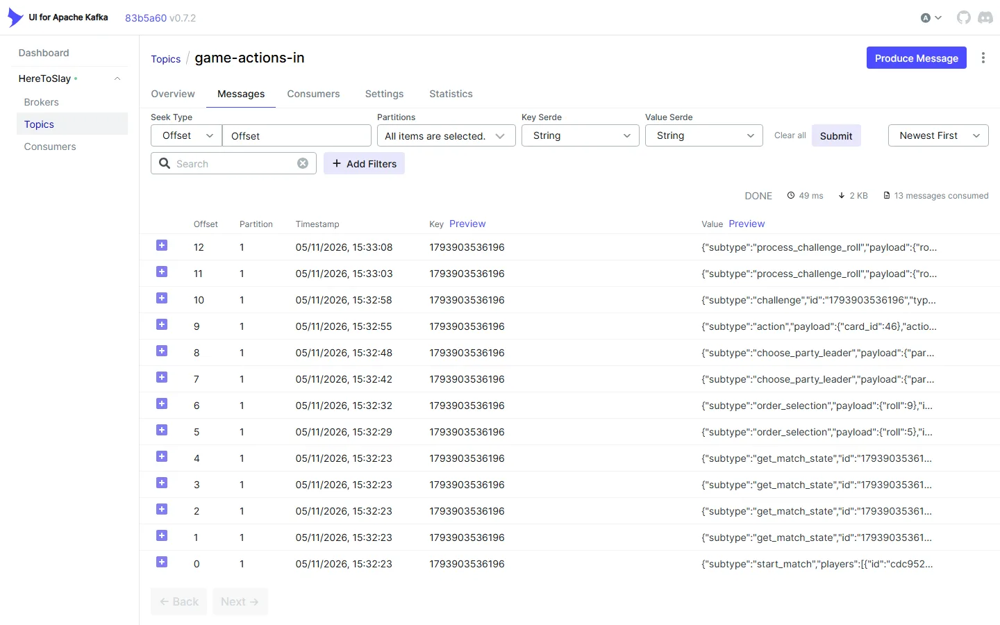
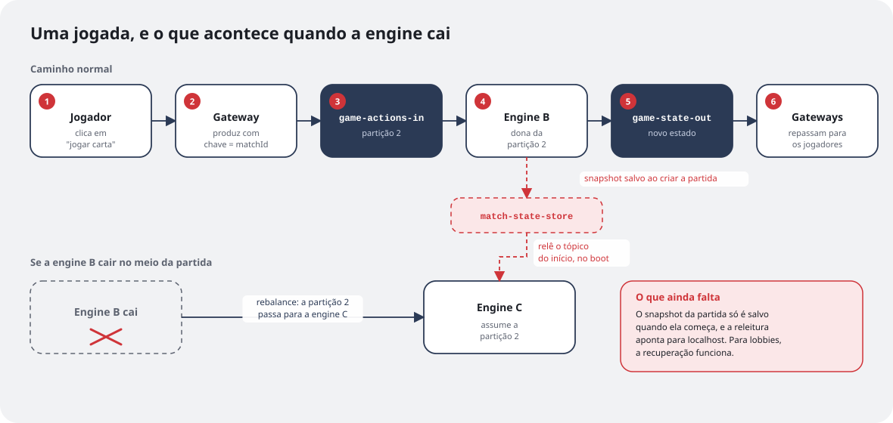
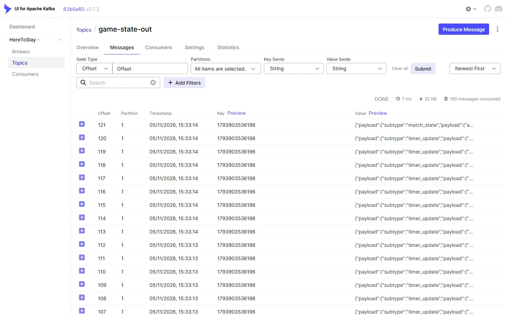

A [parte 2](/pt/textos/here-to-slay-parte-2/) terminou com uma lista de problemas: tudo em memória e num processo só, o jogador identificado pela conexão, uma classe fazendo tudo e nenhum jeito de escalar. O projeto ficou parado alguns meses com essa lista na gaveta, até que, no primeiro semestre de 2026, cursei a disciplina de **Sistemas Orientados a Eventos** na UFES.

Foi ali que eu aprendi Kafka de verdade. E o trabalho da disciplina pedia exatamente um sistema construído em cima dele. Eu tinha um jogo multiplayer com um servidor monolítico pedindo para ser desmontado, então juntei as duas coisas: o Here To Slay virou o trabalho, feito junto com o meu colega Gianluca Mantovaneli.

O trabalho teve duas etapas. A primeira, que é o assunto deste texto, foi usar o Kafka "puro", só com produtores e consumidores, para quebrar o servidor em serviços. A segunda foi um serviço de monitoramento com Kafka Streams, que fica para a parte 4.

## A nova arquitetura

A regra que guiou tudo foi simples: **nenhum serviço chama outro diretamente**. Toda comunicação passa por tópicos do Kafka, inclusive a persistência do estado.



O servidor único virou três serviços:

- **Gateway** (2 réplicas): o único ponto de contato com os clientes. Mantém as conexões WebSocket, mas não tem nenhuma regra de jogo. Cada mensagem do cliente vira uma mensagem no Kafka, e cada resposta que chega do Kafka vai para o jogador certo.
- **Lobby** (2 réplicas): cuida das salas antes da partida começar.
- **Engine** (3 réplicas): é dona das regras do jogo, ou seja, da `Match` e da máquina de estados da parte 2, depois que a partida começa.

Na frente dos gateways fica um **Nginx** fazendo balanceamento de carga dos WebSockets com `least_conn`: cada conexão nova vai para o gateway com menos conexões abertas. E tudo sobe com um `docker compose up`, junto com um Kafka UI para ver as mensagens passando em tempo real.

## Os tópicos

São seis tópicos, organizados em pares de entrada e saída para cada domínio, mais um tópico de estado:

| Tópico | Quem produz | Quem consome |
|---|---|---|
| `lobby-actions-in` | Gateway | Lobby |
| `lobby-state-out` | Lobby | Gateway |
| `lobby-state-store` (compactado) | Lobby | Lobby, ao iniciar |
| `game-actions-in` | Gateway | Engine |
| `game-state-out` | Engine | Gateway |
| `match-state-store` (compactado) | Engine | Engine, ao iniciar |

O gateway ficou quase trivial. Em vez de chamar um serviço, ele só decide em qual tópico a mensagem vai e com qual chave:

```java
case "lobby" -> producer.send(new ProducerRecord<>("lobby-actions-in", routingKey, obj.toString()));
case "match" -> producer.send(new ProducerRecord<>("game-actions-in", obj.get("id").toString(), obj.toString()));
```

## A chave é o que garante a ordem

Num jogo de turnos, a ordem das ações importa: se eu jogo uma carta e depois ataco um monstro, a engine precisa processar nessa ordem. O Kafka só garante ordem **dentro de uma partição**, então a chave de cada mensagem é o `matchId`. Todas as ações da mesma partida caem na mesma partição e chegam em ordem.

Dá para ver isso acontecendo. Rodei de novo a versão de maio de 2026, joguei o começo de uma partida com dois jogadores de teste e abri o `game-actions-in` no Kafka UI:



De baixo para cima, é a partida inteira contada pelo tópico: o `start_match`, as duas rolagens de ordem (5 e 9), as duas escolhas de líder, uma carta jogada, um `challenge` e as duas rolagens do duelo. Todas as mensagens têm a mesma chave, que é o ID da partida, e por isso estão todas na partição 1, na ordem exata em que aconteceram.

Isso também resolve a escala. As três engines entram no **mesmo consumer group** (`heretoslay-engine`), e o Kafka divide as três partições do `game-actions-in` entre elas. Cada partição tem um único dono por vez, então cada partida é processada por exatamente uma engine, sem duas instâncias brigando pelo mesmo estado. Se uma engine cai, o Kafka faz o *rebalance* e passa as partições dela para as outras.



## O truque do gateway: um grupo para cada um

As respostas fazem o caminho contrário, e aí apareceu um problema interessante. Com dois gateways, a conexão WebSocket de um jogador pode estar em qualquer um deles. Se os gateways dividissem as mensagens de `game-state-out` como as engines dividem as ações, metade das respostas iria parar no gateway errado.

A solução foi dar a cada gateway um consumer group só dele:

```java
consumerProps.put("group.id", "heretoslay-gateway-" + UUID.randomUUID());
```

Como cada instância é o único membro do próprio grupo, **todas recebem todas as mensagens**. Cada gateway olha a lista de jogadores da mensagem e repassa só para quem estiver conectado nele. É o mesmo Kafka fazendo duas coisas opostas: dividir trabalho entre as engines e fazer *broadcast* entre os gateways, só mudando o `group.id`.

Outra mudança que veio junto: o jogador deixou de ser a conexão. Agora cada jogador tem um `playerId`, e é esse ID que a engine usa para saber quem é quem. A conexão virou um detalhe do gateway.

## Durabilidade: 3 brokers e `acks=all`

Para não depender de uma máquina só, o cluster tem **3 brokers** rodando em modo **KRaft**, o modo do Kafka que dispensa o ZooKeeper. Cada tópico tem 3 partições e fator de replicação 3, ou seja, cada mensagem existe em três brokers. Do lado dos produtores, o Gianluca configurou `acks=all`: uma mensagem só conta como enviada quando todas as réplicas sincronizadas confirmam que receberam.

## Tópicos compactados como banco de dados

Esta foi a parte que eu mais quis fazer e a que mais me ensinou.

Um tópico **compactado** (`cleanup.policy=compact`) guarda, para cada chave, só a mensagem mais recente. Se cada lobby publica o próprio estado com a chave `lobbyId`, o tópico vira, na prática, uma tabela com o estado atual de todos os lobbies. Ao iniciar, o serviço lê o tópico desde o começo (`auto.offset.reset=earliest`) e reconstrói tudo em memória, sem precisar de banco de dados.

No **lobby**, isso funcionou como planejado: o estado é salvo a cada mudança, e um lobby reiniciado volta exatamente como estava.

Na **engine**, revendo o código para escrever este texto, encontrei duas lacunas:

- o snapshot da partida só é publicado quando a partida **começa**, e não depois de cada jogada;
- a releitura no início aponta para `localhost:9092`, enquanto todo o resto usa o endereço dos brokers que vem do ambiente, então dentro do Docker ela não encontra o cluster.

Na prática, se uma engine cai, a partição dela vai para outra engine, mas a partida não volta do ponto em que estava. A estrutura está toda lá: o tópico compactado, a chave por partida, a releitura no início. Falta salvar depois de cada ação e corrigir o endereço. É o primeiro item da minha lista para a próxima versão, e prefiro contar isso aqui a fingir que está resolvido.

## O que mudou de verdade

Comparando com a parte 2:

- **Escala:** dá para subir mais engines e mais gateways sem mudar uma linha de código. O Kafka redistribui as partições.
- **Ordem:** garantida por partida, pela chave.
- **Desacoplamento:** o gateway não sabe que a engine existe, e vice-versa. Os dois só conhecem tópicos.
- **Observabilidade:** com o Kafka UI, dá para ver cada ação de cada jogador passando pelos tópicos. Isso ajudou muito a depurar.

Para o jogador, por outro lado, nada mudou. As telas dessa versão são idênticas às da parte 2, porque o cliente continuou falando com um WebSocket na mesma porta, sem saber que do outro lado agora existiam três serviços e um cluster. Toda a mudança aconteceu atrás do gateway, e o único lugar onde ela aparece é nos tópicos:



No `game-state-out` aparece o outro lado da conversa: as respostas da engine para a mesma partida, com a mesma chave. A maior parte é `timer_update`, a contagem regressiva da janela de desafio da parte 2, que agora sai a cada 100 ms como mensagem no Kafka em vez de ir direto pelo socket.

O preço também é real: são muito mais peças para subir, mais coisas que podem dar errado e bugs novos que antes não existiam, como os erros de sincronização entre lobbies que precisei corrigir em maio. Para um jogo de cartas entre amigos, é claramente mais arquitetura do que o necessário. Mas o objetivo era aprender, e para isso foi perfeito.

Na parte 4, vou falar da segunda etapa do trabalho: um serviço de monitoramento com Kafka Streams, que observa as partidas e gera alertas como "First Blood" e "Combo" sem encostar no fluxo principal do jogo.
