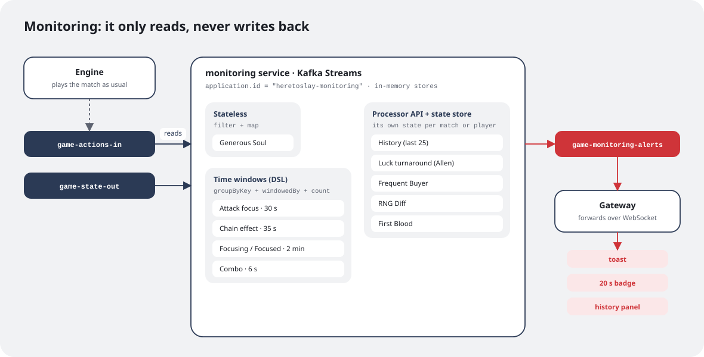
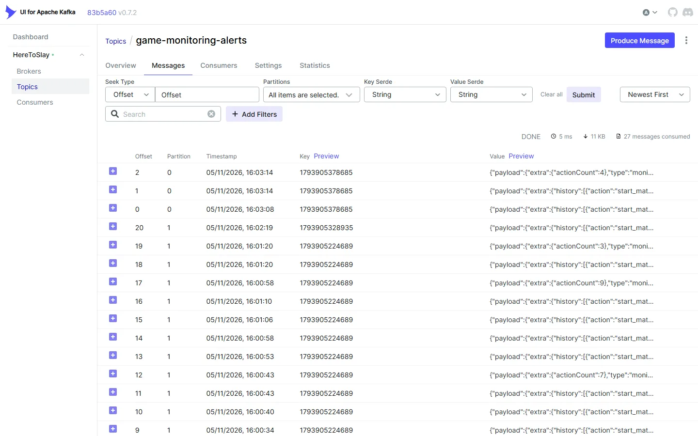
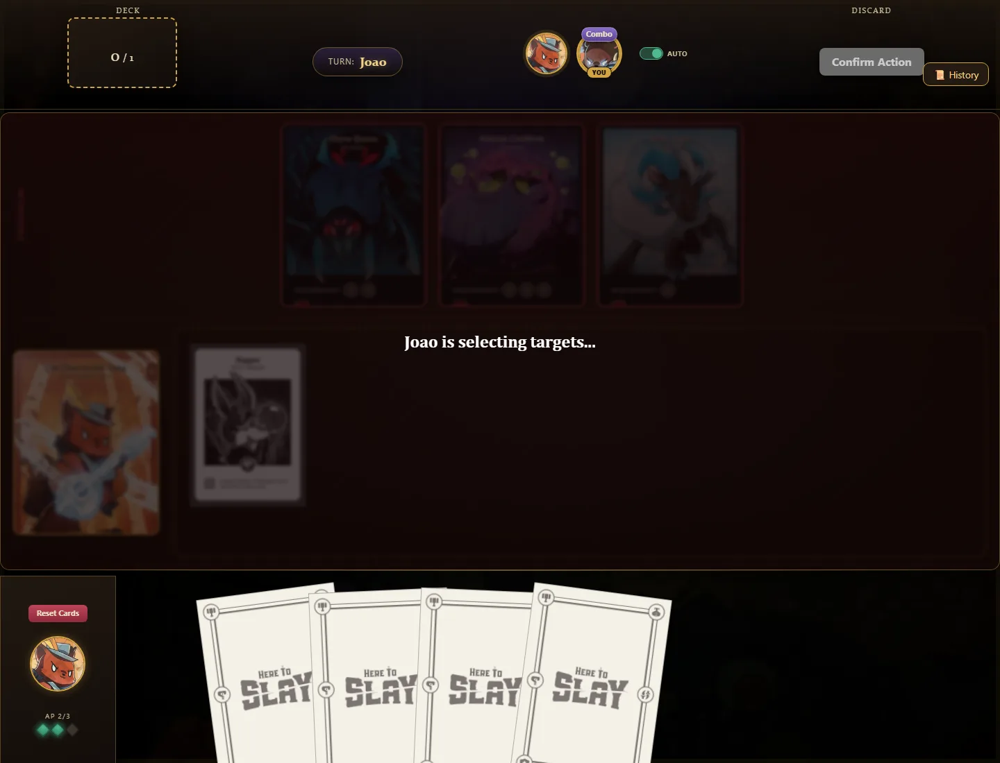
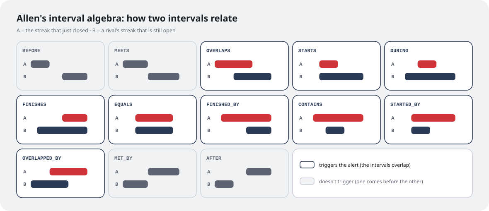
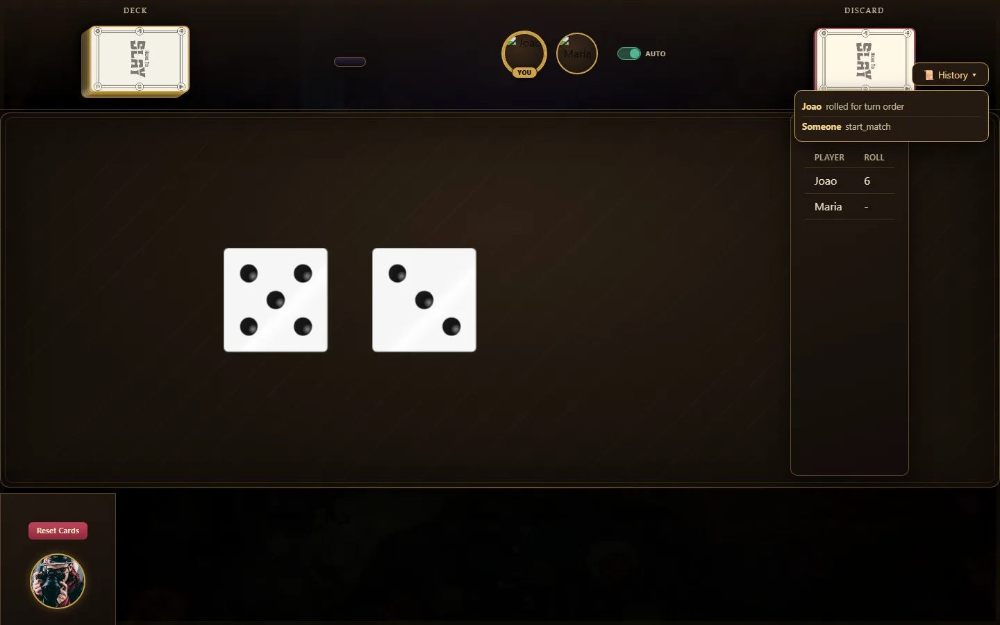
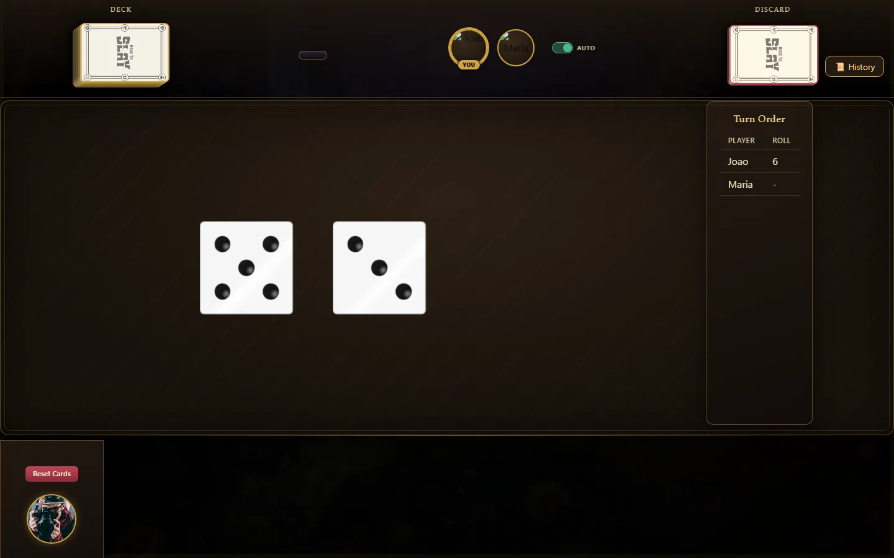
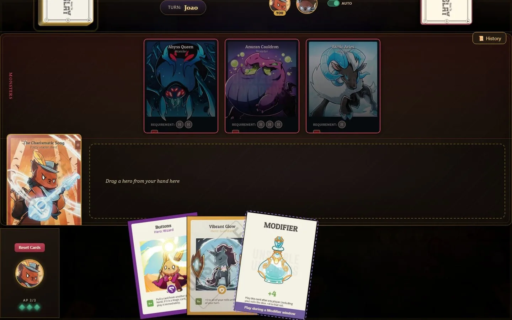
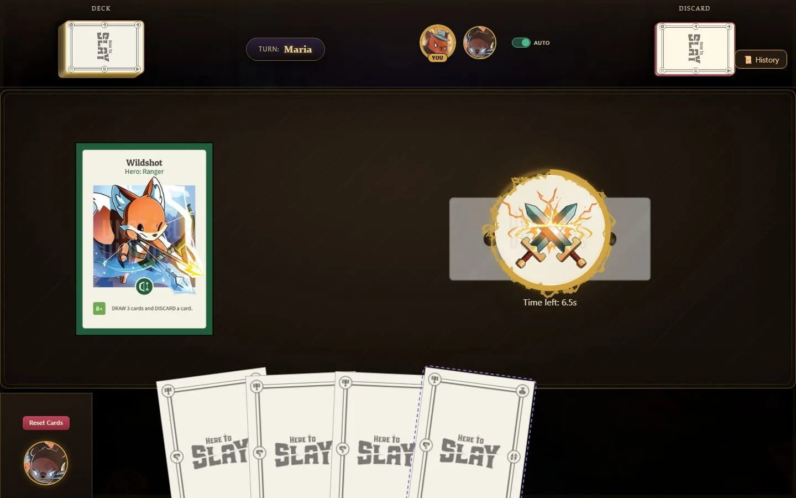
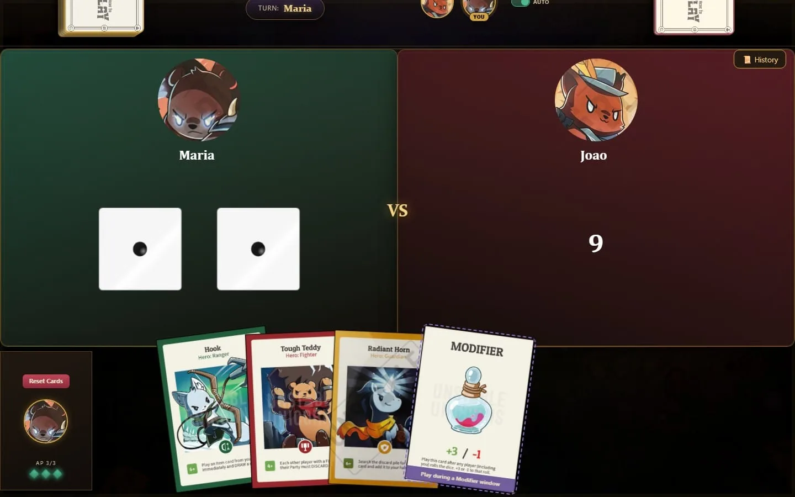
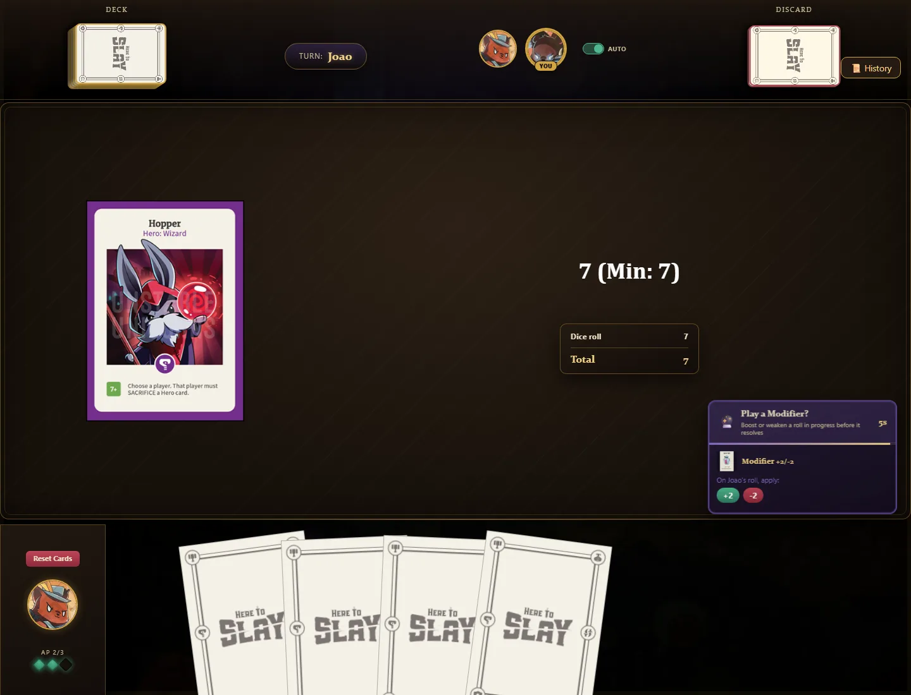

In [part 3](/en/writing/here-to-slay-parte-3/), Here To Slay became a set of services that only talk through Kafka topics. That was the first stage of the Event-Driven Systems course project. The second stage asked for something different: using **Kafka Streams** to process the events already flowing through the system and get information out of them.

We turned that into a game feature: a service that watches matches and hands out "achievements" to players. If someone slays the first monster, everyone gets a **First Blood** notice. If you make three moves in six seconds, you earn a **Combo** badge. Gianluca built the first version of the topology, and I came in later with the event stream, the badges and the action history.

## A service that only watches

The most important decision came before any code: monitoring would be a **separate, read-only service**. It consumes the two topics the engine already uses, `game-actions-in` (what players ask for) and `game-state-out` (what the engine decides), and never writes back to them. The only place it produces to is a new topic, `game-monitoring-alerts`.



That has a great consequence: if the topology has a bug, or if the service goes down, **the match carries on as usual**. Worst case, nobody gets the badge. Monitoring can evolve freely without any fear of breaking the game.

Every alert it produces goes to that topic, keyed by match, like any other event in the system:



The way back reuses what already existed. The gateway consumes `game-monitoring-alerts` and delivers each alert over WebSocket. Some alerts go to the whole match, and to know who is in it the gateway keeps a cache of each match's players, fed by the compacted `match-state-store` topic from part 3.

## Three ways to process an event

There are ten detected situations, and they fall into three categories, each one showing off a different Kafka Streams feature.

**1. Stateless.** Some situations depend on a single event. **Generous Soul** fires when someone plays a positive Modifier on *another* player's roll. All it takes is looking at the message and deciding, so it's just a `filter` and a `map`:

```java
actionsIn
    .filter((key, value) -> isGenerousModifier(value))
    .map((key, value) -> KeyValue.pair(key, MonitoringAlert.generousSoul(actorOf(value))))
    .to("game-monitoring-alerts");
```

**2. Time windows.** Other situations depend on *how many times* something happened within a period. **Combo** is the simplest example: three actions by the same player in six seconds. The key becomes `matchId|playerId`, and messages are grouped by that key and counted inside a time window:

```java
actionsIn
    .map((key, value) -> KeyValue.pair(key + "|" + actorOf(value), value))
    .groupByKey()
    .windowedBy(TimeWindows.ofSizeAndGrace(Duration.ofSeconds(6), Duration.ZERO))
    .count()
    .toStream()
    .filter((windowedKey, count) -> count == 3)
```

The `count == 3` filter makes the alert fire only once, right when the third action arrives. Attack focus (30 s), chain effect (35 s) and Focusing (2 min) follow the same recipe, with different windows and keys.

When the alert arrives, the player gets a tag above their avatar, which stays there for 20 seconds. For the screenshot below, Maria drew three cards in a row on her turn, and right after that the **Combo** tag showed up for both players:



One detail I only noticed while going back through the code: all of these windows are *tumbling*, meaning fixed, non-overlapping blocks of time. If a combo's three actions land half at the end of one window and half at the start of the next, the combo doesn't count. A sliding window would fix that, at the cost of more state. For a just-for-fun badge, the current behavior is acceptable, but it's the kind of choice worth knowing you made.

**3. The Processor API with a state store.** Some situations need a richer memory than a count, and that's where the Processor API comes in: a hand-written processor with its own *state store*. **First Blood** is the simplest of them. It remembers, per match, whether someone has already slain a monster:

```java
if (firstBloodStore.get(matchId) != null) return;   // this match already had its first blood
firstBloodStore.put(matchId, playerId);
context.forward(new Record<>(matchId, MonitoringAlert.firstBlood(playerId), record.timestamp()));
```

**Frequent Buyer** (six card draws in a row), **RNG Diff** (three attacks on a monster without slaying it) and the match's **last 25 actions history** use the same idea, each with its own store.

The stores live in memory. That sounds risky, but Kafka Streams keeps a *changelog topic* behind every store. If the service restarts, it rebuilds its state from that topic. It's the same topic-as-a-database idea from part 3, except here the framework does the work for you.

## The nerdiest situation: Allen's algebra

The **luck turnaround** was the most fun to build. The idea is to detect when two players' luck crosses: while one is on a streak of good rolls, the other's streak ends, for example.

Each player has a current streak, which is a time interval `[start, end)` of type **HOT** (successful rolls) or **COLD** (failed rolls). Every roll extends the open streak or, if the result flipped, closes the current one and opens a new one.

To compare two streaks, I used **Allen's interval algebra**, which defines exactly 13 ways two intervals can relate in time:



When a player's streak closes, the processor compares that interval with each rival's still-open streak. If the relation is one of the nine where the intervals actually overlap, the two players' luck crossed in time, and the game tells everyone. If one interval simply comes before the other (`BEFORE`, `MEETS`, `MET_BY`, `AFTER`), there's no turnaround at all. The whole classification fits in a sequence of comparisons between starts and ends:

```java
if (ae < bs) return BEFORE;
if (ae == bs) return MEETS;
if (as == bs && ae == be) return EQUALS;
if (as > bs && ae < be) return DURING;
// ... and so on, up to all 13 relations
```

## What changed along the way

The topology wasn't born like this. Two changes tell its evolution well:

- **A join that became a history.** The first version of situation 1 was a *join* between `game-actions-in` and `game-state-out`, over a 2-second window, pairing each action with its result. It worked, but all it produced was a generic "action processed" notice. We replaced it with a processor that keeps the match's last 25 actions and sends the whole list, which became a history panel on the game screen. We went from a join to an aggregation with a state store, and the feature got a lot more useful.
- **A situation that went away.** There was a "stalled match" alert, with a *session window* that detected 60 seconds without any action. It didn't make it into the final version.

On screen, the history became a **History** button in the corner of the table. It opens the list of the match's latest actions, built entirely by the monitoring service:



The "Someone start_match" on the last line shows exactly where the list comes from: the start of the match is published by the engine, with no player as its author, and the panel shows the event just as it went through the topic.

For me, that was the most interesting lesson of this stage: with events already flowing through Kafka, building a new feature became a matter of **reading what already exists** in a different way, without touching a single line of the engine. And that only works because of the architecture from part 3.

This was also the stage where the game screen changed for the first time since part 2. The light table with the pixel-art scenery gave way to a dark one, the turn became a badge at the top, and the history got a spot next to the deck and the discard pile. The logic underneath was the same; only the look changed:



The table also got what was missing in part 2. **Monsters** sit at the top, each with the requirements to attack it, and below them is the player's party, with the leader on the left and an area to drag heroes into from the hand. In the corner, the three diamonds are the turn's action points, and the **modifier** card in the hand already says when it can be played: during a modifier window, after a roll.



The challenge window and the duel follow the same logic as in part 2, just with the new look. Here Maria played Wildshot, and João sees the challenge button with 6.5 seconds to decide:



In the duel, green against red, João has already rolled 9, and Maria is about to roll. Look at her hand: a +3/-1 modifier, which could change that result in the modifier window that opens after the roll.



The modifier window itself shows up as a panel in the corner of the screen, for every player holding a modifier. It lasts 5 seconds and shows, for each card, the possible values and which roll they apply to. Here João rolled 7 to trigger a hero's effect that needed at least 7, and Maria can add 2 to that roll or take 2 away:



## After the course

Once the semester ended, the project was handed in, and Here To Slay could have stopped right there. But the goal since [part 1](/en/writing/here-to-slay-parte-1/) was never passing a course: it was playing with my friends. And for that, a lot was still missing. Several base-game cards didn't exist or didn't follow the official rules, the interface only made sense to whoever was taking their turn, the game only ran on my machine, and there was no way to play alone.

In late October 2026 I came back to the project with a new goal: turning the course project into a real game. The next parts tell that story. Part 5 is about the biggest refactor in the project: rewriting the effects of all 68 cards.
