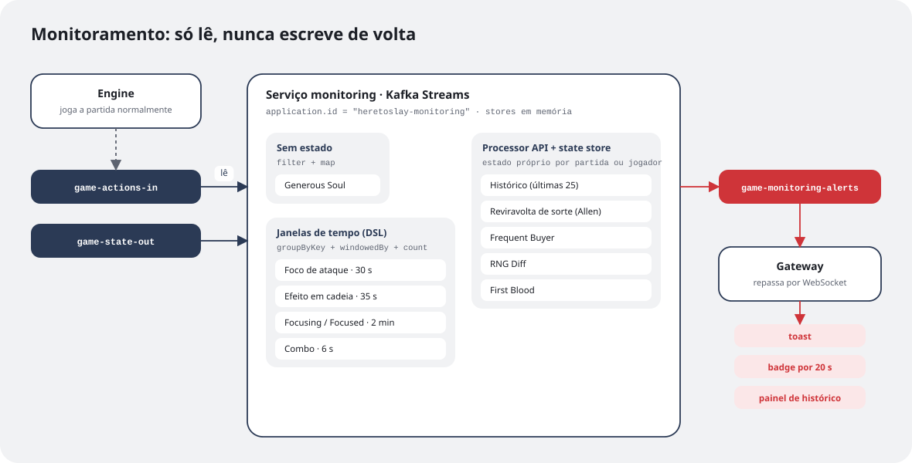
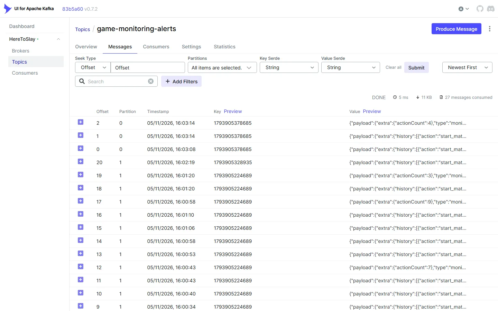
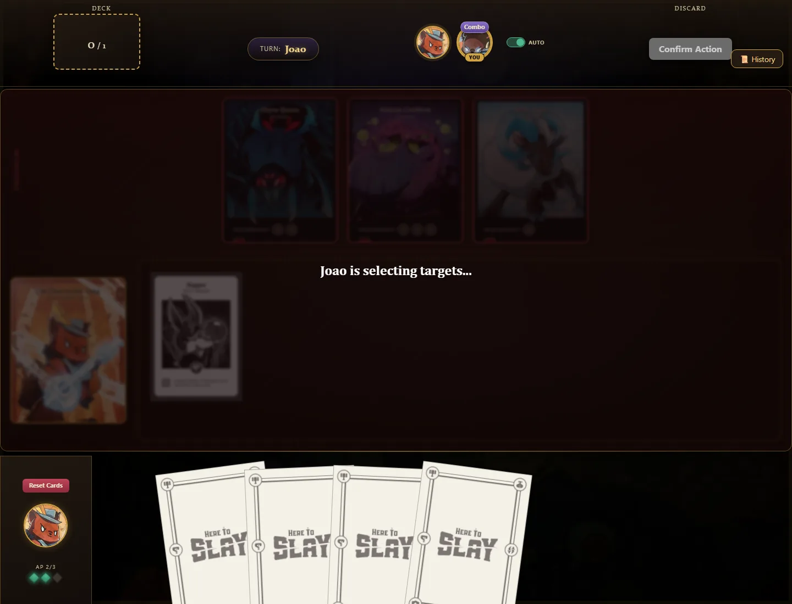
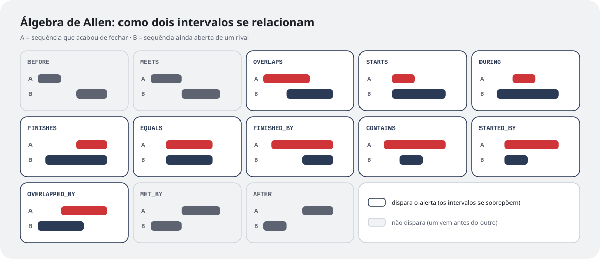
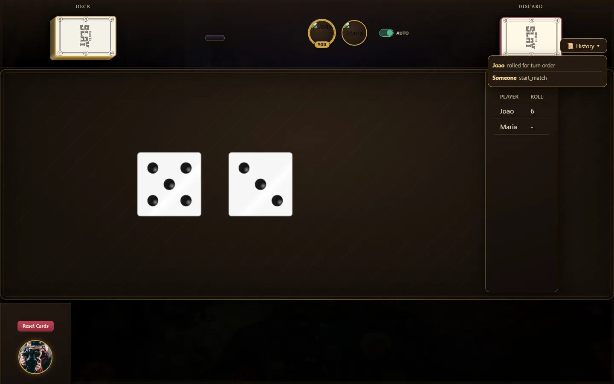
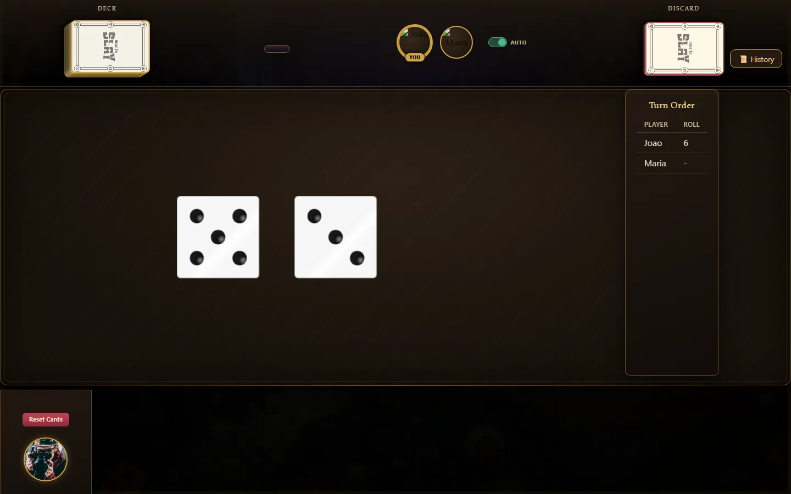
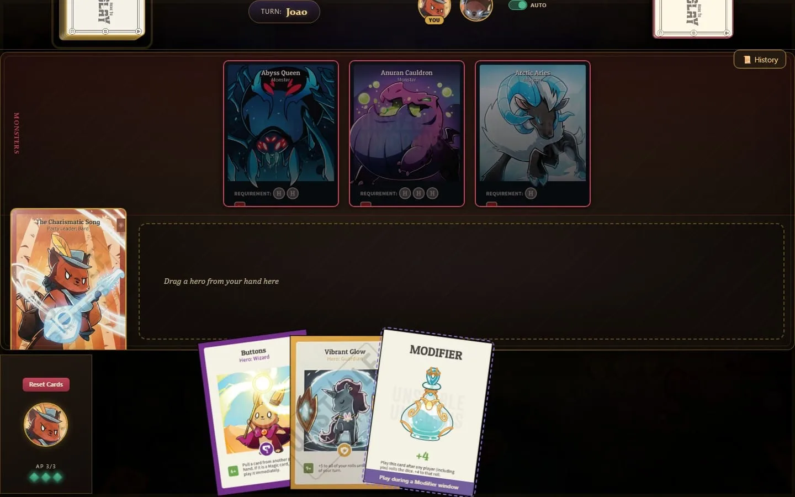
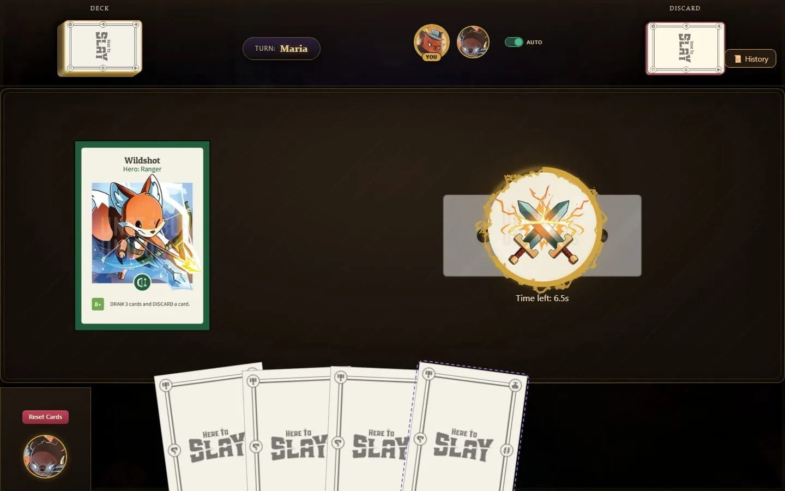
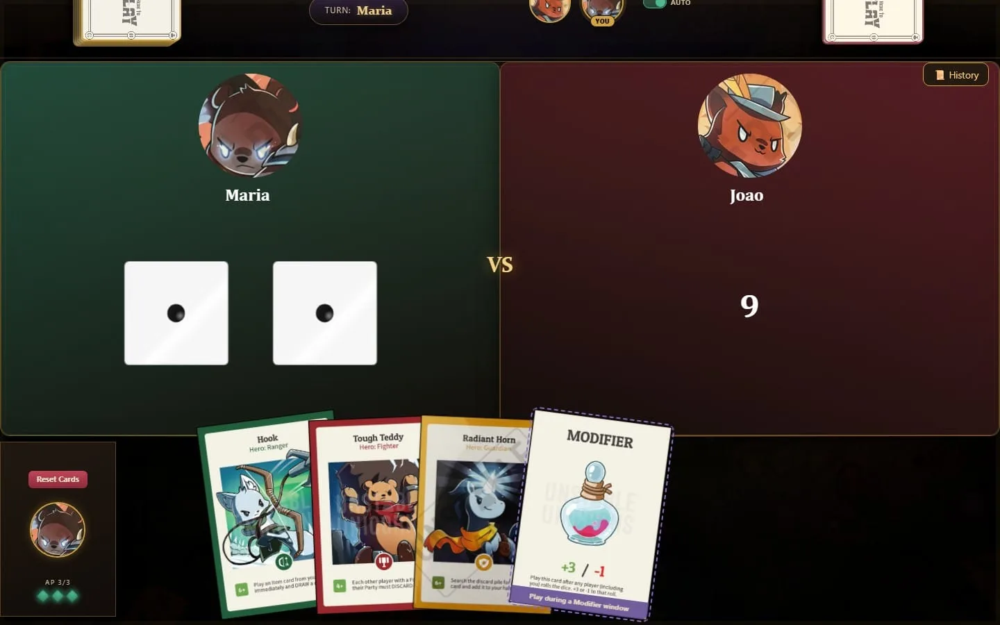
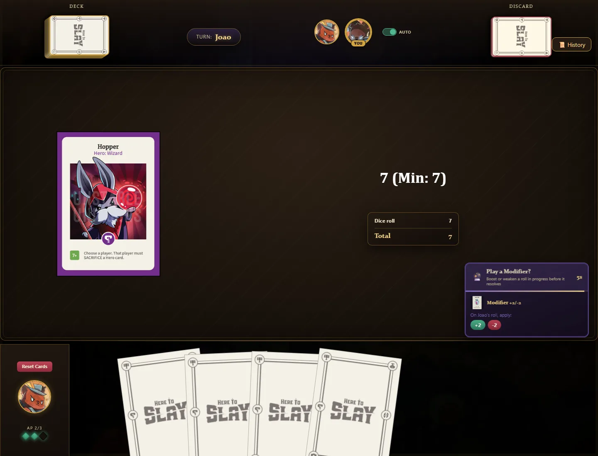

Na [parte 3](/pt/textos/here-to-slay-parte-3/), o Here To Slay virou um conjunto de serviços que só conversam por tópicos do Kafka. Essa foi a primeira etapa do trabalho da disciplina de Sistemas Orientados a Eventos. A segunda etapa pedia algo diferente: usar o **Kafka Streams** para processar os eventos que já estavam passando pelo sistema e tirar informação deles.

A gente transformou isso numa feature do jogo: um serviço que assiste às partidas e dá "conquistas" para os jogadores. Se alguém derrota o primeiro monstro, todo mundo recebe um aviso de **First Blood**. Se você faz três ações em seis segundos, ganha uma badge de **Combo**. O Gianluca montou a primeira versão da topologia, e eu entrei depois com o stream de eventos, as badges e o histórico de ações.

## Um serviço que só observa

A decisão mais importante veio antes de qualquer código: o monitoramento seria um **serviço separado, que só lê**. Ele consome os dois tópicos que a engine já usa, `game-actions-in` (o que os jogadores pedem) e `game-state-out` (o que a engine decide), e nunca escreve de volta neles. O único lugar onde ele produz é um tópico novo, `game-monitoring-alerts`.



Isso tem uma consequência ótima: se a topologia tiver um bug, ou se o serviço cair, **a partida continua igual**. No pior caso, ninguém recebe a badge. Dá para evoluir o monitoramento à vontade sem medo de quebrar o jogo.

Os alertas que ele gera vão todos para esse tópico, com a chave da partida, como qualquer outro evento do sistema:



O caminho de volta reaproveita o que já existia. O gateway consome `game-monitoring-alerts` e entrega cada alerta pelo WebSocket. Alguns alertas vão para a partida inteira, e para saber quem está nela o gateway mantém um cache dos jogadores de cada partida, alimentado pelo tópico compactado `match-state-store` da parte 3.

## Três jeitos de processar um evento

São dez situações detectadas, e elas caem em três categorias, cada uma mostrando um recurso diferente do Kafka Streams.

**1. Sem estado.** Algumas situações dependem de um único evento. O **Generous Soul** dispara quando alguém joga um Modifier positivo no dado de *outro* jogador. Basta olhar a mensagem e decidir, então é só um `filter` e um `map`:

```java
actionsIn
    .filter((key, value) -> isGenerousModifier(value))
    .map((key, value) -> KeyValue.pair(key, MonitoringAlert.generousSoul(actorOf(value))))
    .to("game-monitoring-alerts");
```

**2. Janelas de tempo.** Outras situações dependem de *quantas vezes* algo aconteceu num intervalo. O **Combo** é o exemplo mais simples: três ações do mesmo jogador em seis segundos. A chave vira `matchId|playerId`, as mensagens são agrupadas por essa chave e contadas dentro de uma janela de tempo:

```java
actionsIn
    .map((key, value) -> KeyValue.pair(key + "|" + actorOf(value), value))
    .groupByKey()
    .windowedBy(TimeWindows.ofSizeAndGrace(Duration.ofSeconds(6), Duration.ZERO))
    .count()
    .toStream()
    .filter((windowedKey, count) -> count == 3)
```

O filtro `count == 3` faz o alerta sair uma vez só, no momento em que a terceira ação chega. Foco de ataque (30 s), efeito em cadeia (35 s) e Focusing (2 min) seguem a mesma receita, com janelas e chaves diferentes.

Quando o alerta chega, o jogador ganha uma tag em cima do avatar, que fica lá por 20 segundos. Para tirar o print abaixo, a Maria comprou três cartas seguidas no turno dela, e logo depois a tag **Combo** apareceu para os dois jogadores:



Um detalhe que só percebi revendo o código: todas essas janelas são *tumbling*, ou seja, blocos fixos de tempo que não se sobrepõem. Se as três ações de um combo caem metade no fim de uma janela e metade no começo da próxima, o combo não conta. Uma janela deslizante resolveria, ao custo de mais estado. Para uma badge de brincadeira, o comportamento atual é aceitável, mas é o tipo de escolha que vale saber que você fez.

**3. Processor API com state store.** Algumas situações precisam de uma memória mais rica do que uma contagem, e aí entra a Processor API: um processador escrito à mão, com um *state store* próprio. O **First Blood** é o mais simples deles. Ele guarda, por partida, se alguém já derrotou um monstro:

```java
if (firstBloodStore.get(matchId) != null) return;   // já teve first blood nesta partida
firstBloodStore.put(matchId, playerId);
context.forward(new Record<>(matchId, MonitoringAlert.firstBlood(playerId), record.timestamp()));
```

O **Frequent Buyer** (seis compras de carta seguidas), o **RNG Diff** (três ataques a um monstro sem conseguir derrotá-lo) e o **histórico das últimas 25 ações** da partida usam a mesma ideia, cada um com o seu store.

Os stores ficam em memória. Isso parece arriscado, mas o Kafka Streams mantém por trás de cada store um *changelog topic*. Se o serviço reinicia, ele reconstrói o estado a partir desse tópico. É a mesma ideia de tópico como banco de dados da parte 3, só que aqui o framework faz o trabalho sozinho.

## A situação mais nerd: álgebra de Allen

A **reviravolta de sorte** foi a mais divertida de implementar. A ideia é detectar quando a sorte de dois jogadores se cruza: enquanto um está numa sequência de dados bons, a do outro termina, por exemplo.

Cada jogador tem uma sequência atual, que é um intervalo de tempo `[início, fim)` do tipo **HOT** (rolagens de sucesso) ou **COLD** (rolagens de falha). Toda rolagem estende a sequência aberta ou, se o resultado virou, fecha a atual e abre uma nova.

Para comparar duas sequências, usei a **álgebra de intervalos de Allen**, que define exatamente 13 maneiras de dois intervalos se relacionarem no tempo:



Quando a sequência de um jogador fecha, o processador compara esse intervalo com a sequência ainda aberta de cada rival. Se a relação for uma das nove em que os intervalos realmente se sobrepõem, a sorte dos dois se cruzou no tempo, e o jogo avisa todo mundo. Se um intervalo só vem antes do outro (`BEFORE`, `MEETS`, `MET_BY`, `AFTER`), não tem reviravolta nenhuma. A classificação inteira cabe numa sequência de comparações entre os inícios e os fins:

```java
if (ae < bs) return BEFORE;
if (ae == bs) return MEETS;
if (as == bs && ae == be) return EQUALS;
if (as > bs && ae < be) return DURING;
// ... e assim por diante, até as 13 relações
```

## O que mudou pelo caminho

A topologia não nasceu assim. Duas mudanças contam bem como ela evoluiu:

- **Um join que virou histórico.** A primeira versão da situação 1 era um *join* entre `game-actions-in` e `game-state-out`, numa janela de 2 segundos, que juntava cada ação com o seu resultado. Funcionava, mas só gerava um aviso genérico de "ação processada". Trocamos por um processador que guarda as últimas 25 ações da partida e manda a lista inteira, que virou um painel de histórico na tela do jogo. Saímos de um join para uma agregação com state store, e a feature ficou muito mais útil.
- **Uma situação que saiu.** Existia um alerta de "partida travada", com uma *session window* que detectava 60 segundos sem nenhuma ação. Ele acabou saindo da versão final.

Na tela, o histórico virou um botão **History** no canto da mesa. Ele abre a lista das últimas ações da partida, montada inteiramente pelo serviço de monitoramento:



O "Someone start_match" na última linha mostra bem de onde a lista vem: o início da partida é publicado pela engine, sem nenhum jogador como autor, e o painel mostra o evento do jeito que ele passou pelo tópico.

Para mim, essa foi a lição mais interessante da etapa: com os eventos já fluindo pelo Kafka, criar uma feature nova virou uma questão de **ler o que já existe** de um jeito diferente, sem mexer em uma linha da engine. E isso só funciona por causa da arquitetura da parte 3.

Foi também nessa etapa que a tela do jogo mudou pela primeira vez desde a parte 2. A mesa clara com o cenário em pixel art deu lugar a uma mesa escura, o turno virou um selo no topo, e o histórico ganhou espaço ao lado do baralho e do descarte. A lógica por baixo era a mesma, só a cara mudou:



A mesa também ganhou o que faltava na parte 2. No alto ficam os **monstros**, cada um com os requisitos para ser atacado, e embaixo deles o grupo do jogador, com o líder à esquerda e uma área para arrastar os heróis da mão. No canto, os três losangos são os pontos de ação do turno, e a carta de **modificador** na mão já avisa quando pode ser jogada: durante uma janela de modificador, depois de uma rolagem.



A janela de desafio e o duelo seguem a mesma lógica da parte 2, só com a cara nova. Aqui a Maria jogou o Wildshot, e o João vê o botão de desafio com 6,5 segundos para decidir:



No duelo, verde contra vermelho, o João já rolou 9, e a Maria ainda vai rolar. Repare na mão dela: um modificador de +3/-1, que poderia mudar esse resultado na janela de modificador que abre depois da rolagem.



A janela de modificador em si aparece como um painel no canto da tela, para todo jogador que tem um modificador na mão. Ele dura 5 segundos e mostra, para cada carta, os valores possíveis e em qual rolagem eles vão valer. Aqui o João rolou 7 para ativar o efeito de um herói que pedia no mínimo 7, e a Maria pode somar 2 ou tirar 2 dessa rolagem:



## Depois da disciplina

Com o fim do semestre, o trabalho estava entregue, e o Here To Slay podia ter parado por aqui. Só que o objetivo desde a [parte 1](/pt/textos/here-to-slay-parte-1/) nunca foi passar numa disciplina: era jogar com os meus amigos. E, para isso, ainda faltava muita coisa. Várias cartas do jogo base não existiam ou não seguiam as regras oficiais, a interface só fazia sentido para quem estava jogando a vez, o jogo só rodava na minha máquina, e não tinha como jogar sozinho.

Então eu não parei. Depois da entrega, continuei desenvolvendo o jogo no resto do tempo, agora com uma meta nova: transformar o trabalho da disciplina num jogo de verdade. As próximas partes contam esse caminho. A parte 5 é sobre a maior refatoração do projeto: reescrever os efeitos de todas as 68 cartas.
